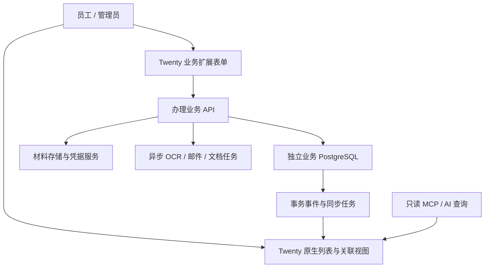

# 架构与数据设计

状态：设计基线 v0.1，2026-10-30。源码存在的能力与已经完成的集成不同；当前尚未构建业务扩展。

关联：[范围](SCOPE.md) · [权限规格](specs/permissions.md) · [驾照与邮件规格](specs/onboarding-and-mail.md) · [现状证据](reference/current-system.md)。

## 1. 整体结构



首期保留一个模块化业务服务，避免同时引入多个微服务。Twenty 自定义前端与服务身份集成先做 M0 验证；不能把 SDK 导出函数当成已经证明可安装、可安全调用。

## 2. 组件职责与数据权威来源

| 数据/能力 | 权威来源 | Twenty 中的形态 |
|---|---|---|
| 客户档案、负责人、企业与银行业务资料 | 业务数据库 | 只读摘要/关联 + 自定义编辑入口 |
| 申请、状态、定稿、补件及历史事件 | 业务数据库 | 只读办理记录、看板、详情和命令按钮 |
| 原始驾照、证明文件、不可变定稿文件 | 业务材料存储 | 经鉴权的查看入口，避免公开永久 URL |
| 邮箱凭据与服务密钥 | 后端受控存储 | 不进入普通字段、备注、AI 上下文或前端 |
| 邮件同步、归属、译文、草稿、发送状态 | 邮件业务模块 | 扩展收件箱与客户/申请关联入口 |
| 普通个人待办、备注 | Twenty 或明确划定的协作模块 | 原生能力优先 |
| 与客户办理有关的待办、通知、状态 | 业务服务派生 | 只读投影；完成业务待办也通过办理命令 |
| 内部聊天历史 | 旧系统只读归档，待范围决策 | 不默认转换成客户邮件或公开备注 |

一个字段只有一个权威写入方。禁止双向自由同步同一个业务字段。业务事务先持久化结果和 outbox 事件，再由可重试的同步任务更新 Twenty 摘要；同步失败不重放外部发送或申请动作。工作台显示同步异常/延迟，不把陈旧投影当作业务真值。

## 3. 推荐代码目录（尚未创建）

```text
apps/business-api/src/
  auth/                 验证 Twenty 用户身份、映射业务身份
  modules/customers/    客户档案及负责人
  modules/onboarding/   驾照批次、识别、核对和提交
  modules/filings/      企业人工办理与 EIN 记录
  modules/applications/ 网关申请、定稿、补件和纠正
  modules/mail/         邮件、翻译、草稿与发送
  modules/documents/    文件与定稿访问
  modules/integrations/ Twenty 投影同步及外部适配器
  db/                   Drizzle schema、迁移和事务事件
apps/twenty-app/src/
  objects/              自定义对象与关系定义
  components/           业务页面、表单及客户详情扩展
  navigation/           菜单与命令入口
packages/contracts/src/ 前后端共享契约与业务错误
tests/integration/      跨模块、真实权限及重复事件验证
tests/e2e/              合成用户完整流程
dev/                    独立验证环境配置，不含凭据
scripts/                启动、元数据比对和迁移工具
```

独立 TypeScript 项目，优先沿用 Node 24、Hono、React、Zod、Drizzle、Vitest；Twenty 前端使用当前版本 SDK 适配，具体可用方式由 M0 固定。应用源码运行；数据库与中间件使用 Docker。Twenty 与业务服务可共享一台数据库主机，但使用不同数据库与账号，不直接写 Twenty 内部表。

## 4. 目标模型

| 对象 | 角色与关键关系 |
|---|---|
| CustomerCase（客户办理档案） | 原 customer 的业务承接层；保留编号、负责人、版本、当前阶段、完成状态及来源 ID |
| Person | 自然人联络与身份索引；首版按旧 ID 映射，不按姓名/邮箱自动合并 |
| Company | 法律实体摘要，关联 CustomerCase；首次迁移保持原一档案一公司体验 |
| FormationApplication | 企业设立记录，关联客户、企业、快照、州、申请结果与文件 |
| EinApplication | EIN 的独立阶段/结果，关联设立记录；首版人工登记 |
| GatewayApplication | 一次网关申请，关联客户、企业、平台、定稿、状态、要求和结果 |
| Requirement | 平台明确要求、原邮件证据、期限及处理状态 |
| Document / ApplicationSnapshot | 文件索引与历史定稿；草稿和正式材料区分 |
| Domain / Mailbox | 手动维护的业务资源及邮件接入；不引入 Hostinger 管理 |
| OnboardingBatch / Item | 上传批次、逐项 OCR、核对、决策与幂等建档结果 |
| BusinessEvent / Outbox | 审计、归因、集成同步；与重试执行状态区分 |

Person/Company 在 Twenty 中的摘要不等于将全套敏感字段复制到通用 CRM。首版不自动合并跨客户档案；若未来两个不同负责人档案共用一个自然人或企业，档案业务资料仍按客户归属管理，共享主数据修改须单独授权，不能让修改 A 档案隐式修改 B 档案。

## 5. 写入和负责人权限

1. 员工可按模块权限阅读全部客户资料；负责人或管理员才可执行对应客户业务写操作。
2. 普通员工对 Twenty 原生业务对象只读，包括新增、修改、软删和硬删；办理通过自定义表单调用明确的业务命令。
3. API 从已验证的会话解析用户，再从数据库解析目标对象所属客户；不接受请求体中的用户或负责人声明作为权限依据。
4. 独立服务写入凭据只留后端。员工 MCP、原生工作流、导入、发信动作和 record sharing 不得提供绕过上述边界的写入口。
5. 改派负责人是管理员命令，更新负责人及权限版本、记录事件；执行中的编辑和待发送动作检查最新版本。
6. 原始操作人、提交人、定稿确认人保留历史，不因转交被改写。

这是静态对象权限加自建业务授权，不依赖 Twenty 的企业版动态 RLS。代价是受控业务字段不提供原生任意单元格编辑。真实角色、SDK、身份和旁路验证是 M0 的退出标准，未通过前不能投入真实客户数据。

## 6. 关键业务命令与事务

| 命令 | 必须保证 |
|---|---|
| confirmOnboardingItem / submitOnboardingItems | 人工核对、重复处理、每项独立事务、相同项重放返回原结果 |
| updateCustomerDossier | 功能权限 + 当前负责人 + 版本检查 + 字段归因 |
| reassignCustomer | 管理员、权限版本更新、审计、待办归属调整 |
| createFormation / recordFormationResult / recordEinResult | 人工流程状态合法、文件/结果对应、禁止隐含自动提交 |
| startGatewayApplication | 锁客户、单在办、资料/附件定稿、排除草稿、幂等 |
| transitionGatewayApplication / correctApplicationResult | 允许的状态转换、原文证据或人工理由、完成状态重算 |
| translateMessage | 读取范围、模型配置、译文缓存；无申请/补件/发送副作用 |
| generateReplyDraft / sendReply | 办理权限、当前负责人、正确客户附件、二次确认及发送幂等 |

函数名是设计接口建议，具体参数在每阶段执行计划中锁定；本文件不声称旧模块可原样复制运行。

## 7. 邮件与后台任务

- 后台同步属于系统接入，记录系统身份；纯翻译任务与修改业务事实的任务分开。
- 非负责人可在拥有邮件/AI查看能力时翻译或查看译文；不能借“读懂”创建补件、改状态或起草/发送回复。
- 已有关联申请的历史邮件按申请客户归属解析，不能因邮箱重绑而改变历史归属。
- 用户触发的业务任务记录 actor、customerId、ownerVersion、幂等键和目的；执行业务写/发送前重新授权。
- 转交发生后，尚未发送的旧负责人动作需要重新确认；已被 SMTP 接受的邮件保留真实结果，不能声称可撤回。
- 发送结果未知进入 unknown 并核实，不自动重发；投影同步重试和外部业务动作重试使用不同任务类型。
- 旧系统自动从邮件推进申请的策略单独决策（Q-03），不能默认为迁移纯翻译所附带的权限。

## 8. 数据迁移和切换

来源记录带 `sourceSystem/sourceEntity/sourceId/sourceUpdatedAt/migrationBatchId` 映射；首次导入不自动合并自然人。核对客户/申请数量和关系、资料字段、附件 hash、定稿不可变、草稿排除、历史 actor、首个有效获批及负责人分配。

先检查 Twenty 已有自动化，尤其“新增联系人时创建公司”，避免导入产生额外记录。按小批客户切换，每批只有一个权威写入口。运行中/发送中/unknown 任务先核实，不因迁移重放。回退需导出切换后新增事实并对账，不可直接恢复旧库覆盖新发生的外部业务结果。

## 9. 首版以外

企业自动申请、浏览器/指纹环境、代理和设备任务、付款执行与桌面 RPA 均不接入首版。保留历史标识与记录即可，不创建替代自动化。Hostinger、建站、已退役集成不作为后续默认待办。
